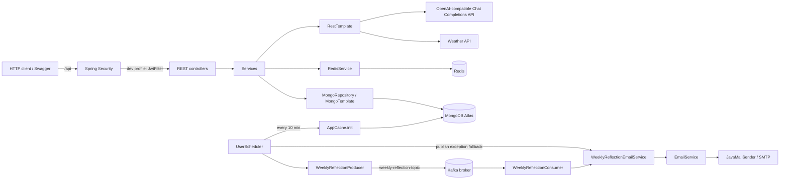
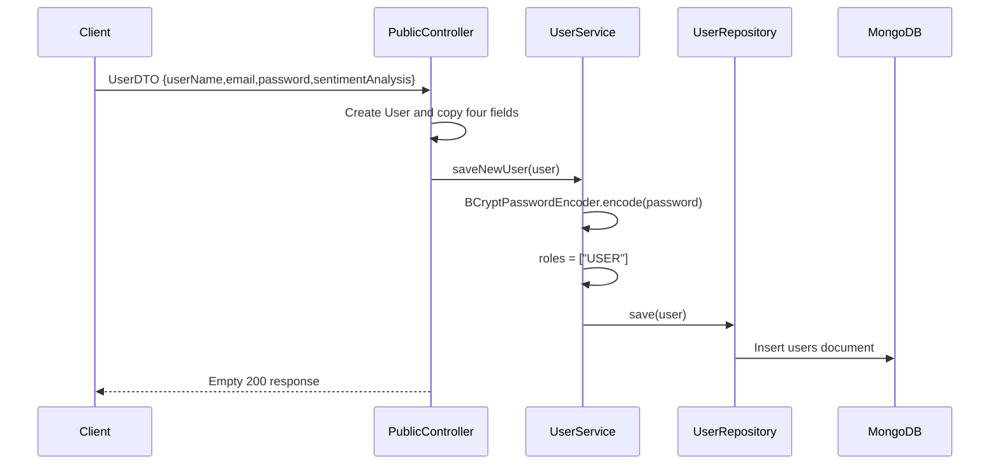
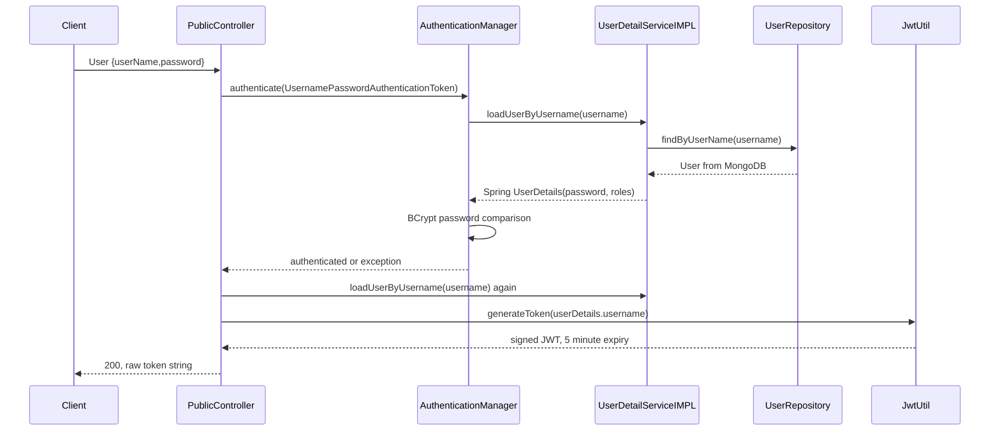
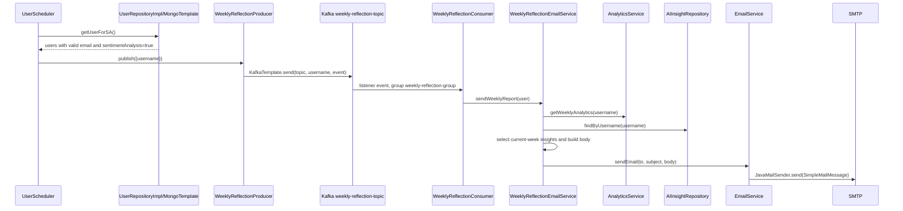

# DKD Workflow Guide — What the Repository Actually Does

This is an implementation guide for interview preparation. It describes the current codebase as it exists, not an idealized design. “DKD” is the Spring Boot backend under `com.tejastomar.journalapp`.

## 1. High-level architecture



### Persistence model

| Mongo collection | Java type | Important relationship |
|---|---|---|
| `users` | `User` | Has a `@DBRef List<JournalEntry> journalEntries`; entries are **not embedded** in a user document. |
| `journal_entries` | `JournalEntry` | Created separately, then its DBRef is appended to the owning `User`. |
| `reflection_prompts` | `ReflectionPrompt` | Admin-created daily prompt catalog. |
| `ai_insights` | `AIInsight` | One insight is looked up by `journalEntryId`; also stores `username` for weekly reports. |
| `config_journal_app` | `ConfigJournalAppEntity` | Key/value configuration loaded into in-memory `AppCache`. |

## 2. Startup and configuration

### Trigger and application classes

`JournalApplication.main()` calls `SpringApplication.run(...)`. The class has:

- `@SpringBootApplication`: component scanning and auto-configuration.
- `@EnableTransactionManagement`: enables `@Transactional` methods.
- `@EnableScheduling`: activates `@Scheduled` methods in `UserScheduler`.
- A `MongoTransactionManager` bean using `MongoDatabaseFactory`.
- A `RestTemplate` bean for weather and OpenAI HTTP calls.

After startup it prints `environment.getActiveProfiles()[0]`. If no active profile exists, that array access can fail; the configured default in `application.yml` is `dev`.

### Profiles and infrastructure configuration

- `application-dev.yml` configures MongoDB, Redis, SMTP, Kafka at `localhost:9092`, server port `8080`, and context path `/api`.
- `application-docker.yml` points Kafka at `host.docker.internal:9092`; MongoDB, Redis, and SMTP are configured there too.
- `Dockerfile` copies a prebuilt `target/*.jar` into an Eclipse Temurin Java 17 image and starts it.
- `docker-compose.yml` starts Redis and the application container. It does **not** start Kafka or MongoDB; those must already be reachable.

> **Repository reality:** secret values are present in the YAML files in the current checkout. They should not be repeated in documentation or exposed publicly; rotate them and move them to environment variables before deployment.

### Security profile selection

- `SpringSecurity` is active only under `dev` and installs `JwtFilter` before `UsernamePasswordAuthenticationFilter`.
- `SpringSecurityProd` is active only under `prod`, requires authentication for almost every route, and enables HTTP Basic. It does **not** install `JwtFilter`. Consequently, JWT-based behavior documented below is the dev-profile behavior; production currently has materially different authentication behavior.

### Startup cache

`AppCache` has `@PostConstruct init()`. It calls `ConfigJournalAppRepository.findAll()`, creates a fresh `HashMap`, then inserts every `ConfigJournalAppEntity.key/value` pair. It is an **in-process Java map**, not a Redis cache. `UserScheduler.clearAppCache()` repeats this process every ten minutes, and `GET /admin/clear-app-cache` can trigger it manually.

Expected keys used by code are `WEATHER_API`, `OPENAI_MODEL`, `OPENAI_BASE_URL`, `OPENAI_TEMPERATURE`, `OPENAI_MAX_TOKENS`, and `AI_SYSTEM_PROMPT`.

## 3. User registration

**Entry point:** `POST /api/public/signup`



`PublicController.signup(@RequestBody UserDTO user)` creates a separate `User` and copies `email`, `userName`, `password`, and `sentimentAnalysis`. `UserService.saveNewUser()` hashes the supplied password with its own static `BCryptPasswordEncoder`, overwrites roles with `USER`, then uses `UserRepository.save`.

**Important actual behavior and failures:**

- `UserDTO` has `@NotEmpty` annotations, but the controller does not use `@Valid`; those constraints are not automatically enforced here.
- `saveNewUser()` catches every exception, logs generic/noisy messages, and returns `false`. `signup()` ignores that boolean and always returns `void`; a caller cannot distinguish failed persistence from success from this endpoint response.
- The unique Mongo index on `User.userName` is the persistence-level protection against duplicate usernames.

## 4. Login and JWT authentication

**Entry point:** `POST /api/public/login`



`PublicController.login()` constructs a `UsernamePasswordAuthenticationToken` containing the supplied username/password and sends it to the `AuthenticationManager` bean exposed by dev `SpringSecurity.authenticationManagerBean()`.

The configured authentication manager calls `UserDetailServiceIMPL.loadUserByUsername()`. It queries `UserRepository.findByUserName`, builds Spring Security’s `org.springframework.security.core.userdetails.User` with the stored BCrypt hash and `roles`, or throws `UsernameNotFoundException`. `AuthenticationManagerBuilder` was configured with this service and a BCrypt encoder, so the provider checks the supplied password against the stored hash.

On success, the controller queries `UserDetailServiceIMPL` a second time and calls `JwtUtil.generateToken(username)`. The token contains an empty claims map, subject = username, issued-at time, and expiration = now + 5 minutes. It is HMAC-signed with the hard-coded key in `JwtUtil`.

On **any** exception, the controller logs it and returns `400 Bad Request` with `Incorrect Username or password`. It returns only the token string, not a JSON envelope.

## 5. Authenticated request: exact JWT validation path

**Representative entry point:** `GET /api/dashboard` with `Authorization: Bearer <token>` while the `dev` profile is active.

```mermaid
sequenceDiagram
    participant Client
    participant F as JwtFilter
    participant JU as JwtUtil
    participant UDS as UserDetailServiceIMPL
    participant DB as MongoDB
    participant SC as SecurityContextHolder
    participant C as Protected controller
    Client->>F: Authorization: Bearer JWT
    F->>JU: extractUsername(jwt)
    JU->>JU: Verify HMAC; parse signed claims
    JU-->>F: subject / username
    F->>UDS: loadUserByUsername(username)
    UDS->>DB: findByUserName(username)
    DB-->>UDS: User
    F->>JU: validateToken(jwt)
    JU->>JU: parse again, check expiration only
    F->>SC: set UsernamePasswordAuthenticationToken(UserDetails, authorities)
    F->>C: chain.doFilter; authorization then controller
```

`JwtFilter` extends `OncePerRequestFilter` and is placed before `UsernamePasswordAuthenticationFilter` in dev security.

1. It reads the `Authorization` header.
2. Only a header beginning exactly with `Bearer ` is used; the remaining substring is the JWT.
3. `JwtUtil.extractUsername()` parses signed claims, verifies signature with the hard-coded signing key, and reads the `sub` claim.
4. If `username != null`, `UserDetailServiceIMPL` queries MongoDB for fresh `UserDetails`.
5. `JwtUtil.validateToken()` parses the token again and checks only whether its expiration is before the current time. Signature verification happens indirectly during parsing.
6. On validation, it creates `UsernamePasswordAuthenticationToken(userDetails, null, userDetails.getAuthorities())`, attaches `WebAuthenticationDetails`, and writes it to `SecurityContextHolder`.
7. `SecurityUtil.getCurrentUsername()` in controllers retrieves that authentication and returns `authentication.getName()`.

### Missing, malformed, expired, and invalid token behavior

| Situation | Actual behavior |
|---|---|
| Missing header / header without `Bearer ` | Filter sets no authentication and continues. A route requiring `.authenticated()` is denied by Spring Security; a permitted route still runs anonymously. |
| Valid header with malformed JWT, invalid signature, bad parsing, expired JWT | `extractUsername()` or `validateToken()` throws from JJWT. `JwtFilter` has no catch block, so it does **not** convert this into a custom JSON error; standard servlet/Spring error handling applies. |
| Token subject is absent | `username` remains null, filter continues without authentication. |
| Subject does not correspond to a user | `UserDetailsService` throws before `chain.doFilter`; no special local response is made. |
| Valid token but no required authority | Authentication exists, but Spring Security authorization denies the route. |

There is no refresh-token implementation, no token revocation store, and no custom authentication entry point in this repository.

## 6. Authorization and RBAC

In dev `SpringSecurity.configure(HttpSecurity)`:

- `/journal/**`, `/user/**`, `/dashboard/**`, `/analytics/**`, `/reflection/today`, and `/ai/**` require an authenticated identity.
- `/admin/**` and `/reflection/**` require `hasRole("ADMIN")`. Because `/reflection/today` appears first, it is user-accessible; all other reflection URLs require admin.
- Any other route is permitted, including `/public/**` and Swagger routes.

`UserDetailServiceIMPL` calls `.roles(user.getRoles().toArray(...))`. Spring Security turns `ADMIN` into authority `ROLE_ADMIN`; therefore `hasRole("ADMIN")` matches users whose stored roles include `ADMIN`.

In prod, all routes except the special reflection rules require authentication and HTTP Basic is configured. It does not use the JWT filter. This discrepancy is important to state honestly in an interview.

## 7. Journal lifecycle

### Create

**Entry point:** `POST /api/journal`

1. `JournalEntryController.createEntry()` takes `JournalEntry` directly from the body and gets the authenticated username via `SecurityUtil`.
2. `JournalEntryService.saveEntry(entry, username)` is `@Transactional`.
3. It loads `User`, forcibly sets `entry.date = LocalDateTime.now()`, saves the entry to `journal_entries`, appends that saved object to `user.journalEntries`, then saves the user DBRef list.
4. On success, controller returns `201 Created` with no body despite the generic return type. On any exception it prints a stack trace and returns `400`.

The client can send `sentiment`, `aiEnabled`, `mood`, `tags`, and `reflectionPrompt`; no request DTO or validation restricts these fields.

### Read all and by ID

- `GET /api/journal` loads the authenticated `User`, returns `user.getJournalEntries()` directly, or `404` if null/empty.
- `GET /api/journal/id/{myId}` converts the path text to `ObjectId`, checks that the ID occurs in the current user’s DBRef list, then loads the same ID through `JournalEntryService.findById()` / `JournalEntryRepository.findById()`. It returns `404` if not associated or absent.
- An invalid hex ID can throw while constructing `ObjectId`; no controller exception handler converts it.

### Update

**Entry point:** `PUT /api/journal/id/{myId}`

The controller first confirms the DBRef association. It then loads the entry and replaces only non-empty title/content. It additionally replaces `mood`, `tags`, and `reflectionPrompt` when supplied, always sets `aiEnabled` from the request boolean, and calls `JournalEntryService.saveEntry(old)`, which only saves the journal document.

It does **not** update `date` or `sentiment`, and `aiEnabled` cannot be omitted without becoming `false` because primitive booleans default to false.

### Delete

**Entry point:** `DELETE /api/journal/id/{myId}`

`JournalEntryService.deleteById()` is transactional: it removes the matching item from the user’s DBRef list, saves the user, then deletes the `journal_entries` document. It returns `204` when removed and `404` when no matching ref exists. Exceptions are logged and rethrown as a generic runtime exception.

### Search and filters

**Entry point:** `GET /api/journal/search?title=&sentiment=&startDate=&endDate=&sort=desc`

`JournalSearchService.searchJournalEntries()` loads **only the authenticated user’s** DBRef entries. It performs in-memory filtering:

- title: trimmed, case-insensitive, partial match against `JournalEntry.title` only—not content;
- sentiment: exact enum equality;
- dates: inclusive `LocalDate` bounds using `entry.date`;
- sort: `asc` or `desc`, default `desc`; entries with null dates sort last.

An end date before start date or any sort direction other than `asc`/`desc` becomes `IllegalArgumentException`; the controller turns that into an empty `400 Bad Request`.

## 8. Dashboard workflow

**Entry point:** `GET /api/dashboard`

`DashboardController` passes the SecurityContext username to `DashboardService.getDashboard(username)`, which loads the `User` and uses their DBRef entries. It does not invoke weather, reflection prompts, or AI insights.

| DTO field | Actual calculation |
|---|---|
| `username` | `user.getUserName()`. |
| `totalEntries` | Number of references in the user list. |
| `entriesThisWeek` | Entries dated Monday through today, inclusive. |
| `entriesThisMonth` | Entries in today’s month/year through today. |
| `currentStreak` | Unique non-future entry dates. Start today if journaled today, otherwise yesterday; count consecutive dates backwards. Thus missing today does not break a streak until a full day has been missed. |
| `dominantSentiment` | Most frequent non-null `entry.sentiment` over all entries, with enum declaration order resolving a tie. |
| `lastEntryDate` | Latest non-future entry date. |

No dashboard “recent journals”, weather, or daily reflection prompt field exists in `DashboardResponseDTO`, even though a frontend can call those endpoints separately.

## 9. Weekly analytics workflow

**Entry point:** `GET /api/analytics/weekly`

`AnalyticsService.getWeeklyAnalytics()`:

1. Gets the user from `UserService`.
2. Computes `weekStart = LocalDate.now().with(MONDAY)` and `weekEnd = LocalDate.now()`.
3. Filters DBRef entries whose date is between those dates, inclusive.
4. Builds an `EnumMap<Sentiment,Integer>` using `entry.sentiment`—not `entry.mood`.
5. Reuses `DashboardService.calculateCurrentStreak(allEntries)` rather than duplicating streak logic.
6. `averageEntriesPerDay = weeklyEntryCount / elapsedDays`, where elapsedDays is Monday-to-today plus one.
7. `journalConsistency = unique entry dates / elapsedDays * 100`; multiple journals on a date count once. Both floating values are rounded with `Math.round(value * 100) / 100.0`.

The Swagger text says Monday through Sunday, but the implementation deliberately ends at **today**, not future Sunday. There is no monthly analytics endpoint.

## 10. Reflection-prompt workflow

### User retrieval

**Entry point:** `GET /api/reflection/today`

`ReflectionPromptService.getTodaysPrompt()` calls `findByActiveTrue()`. It throws `IllegalStateException` if none exist; otherwise it sorts active prompts by ObjectId hex string and selects index:

`floorMod(LocalDate.now().toEpochDay(), activePrompts.size())`.

That makes the selected prompt deterministic for a given date **and current active-prompt list**. It does not persist a user-to-prompt assignment or a daily history record. Changing active prompts can change today’s prompt.

### Admin operations

The following require `ROLE_ADMIN` in dev:

- `POST /api/reflection`: uses `@Valid ReflectionPromptRequestDTO`; prompt must be nonblank and 10–300 characters; category is non-null. Saves `createdAt = now`.
- `GET /api/reflection`: returns every prompt mapped to response DTO.
- `PUT /api/reflection/id/{id}`: replaces prompt/category/active; absent ID returns 404.
- `DELETE /api/reflection/id/{id}`: is a **soft delete**; it sets `active=false` and saves. No Mongo document is physically deleted.

`ReflectionPromptResponseDTO` exposes ID, text, and category, but not `active` or `createdAt`.

## 11. AI reflection workflow

**Entry points:** `POST /api/ai/generate/{journalId}` and `GET /api/ai/{journalId}`.

```mermaid
sequenceDiagram
    participant Client
    participant AC as AIInsightController
    participant AIS as AIInsightService
    participant JR as JournalEntryRepository
    participant UR as UserService/UserRepository
    participant AR as AIInsightRepository
    participant AIC as AIConfigurationService
    participant Redis
    participant OA as OpenAIService
    participant API as Chat Completions API
    Client->>AC: POST generate/journalId
    AC->>AIS: generateInsight(current username, ObjectId)
    AIS->>JR: findById
    AIS->>UR: findByUserName and verify DBRef ownership
    AIS->>AR: findByJournalEntryId
    alt Insight already exists
      AR-->>AIS: existing insight
      AIS-->>Client: stored DTO; no OpenAI call
    else New, AI-enabled journal
      AIS->>AIC: getSystemPrompt()
      AIC->>Redis: GET ai_system_prompt
      AIC->>OA: sendPrompt(system prompt, structured journal prompt)
      OA->>API: POST chat/completions JSON mode
      API-->>OA: raw JSON
      AIS->>AIS: parse required fields and Sentiment
      AIS->>AR: save AIInsight
      AIS-->>Client: AIInsightResponseDTO
    end
```

`AIInsightService` first obtains the journal from `JournalEntryRepository.findById`. It then loads the authenticated `User` and checks the journal ID is in the user’s DBRef list. Missing journal gives `404`; a non-owner gets `403`; `aiEnabled == false` gets `400`.

If `AIInsightRepository.findByJournalEntryId(journalId)` returns an insight, it returns it and never regenerates.

For a new insight, `buildPrompt(JournalEntry)` requires nonblank content. It sends structured context where available: title, mood, comma-joined tags, reflection prompt, then journal content. It does not add username, email, JWT, roles, or database IDs to that user prompt.

`AIConfigurationService.getSystemPrompt()` gets `ai_system_prompt` from Redis or reads `AI_SYSTEM_PROMPT` from in-memory `AppCache` and attempts to cache it for 3,600 seconds.

`OpenAIService` reads API key from `${openai.api-key}`, then reads model/base URL/temperature/max tokens from AppCache. It sends a body with separate `system` and `user` messages and `response_format: { type: json_object }`. The code expects a Chat Completions-shaped response at `{choices[0].message.content}`; it parses the content as a second JSON object.

Required model-generated fields are `summary`, `detectedSentiment`, `positiveObservation`, `reflectionQuestion`, and `encouragement`. Sentiment is trimmed, uppercased with `Locale.ROOT`, then converted to the application `Sentiment` enum. It saves `journalEntryId`, all fields, configured model, current generation time, `generated=true`, and username.

### AI error paths

- Missing journal: `404` `ResponseStatusException`.
- Journal belongs to another user: `403`.
- AI disabled / blank content: `400`.
- Failed `RestTemplate` HTTP call: `OpenAIServiceException`, mapped to `502 OpenAI request failed`.
- Unparseable JSON, missing output fields, invalid sentiment: `502` malformed/invalid response error.
- Missing AppCache configuration is an `OpenAIServiceException`; it is caught by the same `502` path only when called within `generateAndParseInsight`.

> **Implementation note:** `AIInsightService` and `OpenAIService` print prompts and raw responses to stdout. Since prompts contain journal content, this is a privacy risk, not a production logging design.

`JournalAIRequestedEvent` and `JournalAIEventProducer` can publish an `ai-insight-generation` message with only `journalEntryId`, but no current controller/service calls this producer and there is no consumer. AI generation is synchronous today.

## 12. Redis workflow: exact caches and failure behavior

`RedisConfig` creates a raw `RedisTemplate` with `StringRedisSerializer` for keys and values. `RedisService` serializes values to JSON using a new `ObjectMapper` on each get/set.

| Cache | Key | Value | TTL | Hit | Miss/population | Redis failure behavior |
|---|---|---|---|---|---|---|
| Weather | `weather_of_` + city | JSON serialized `WeatherResponse` | 300 seconds | `WeatherService.getWeather()` returns it without HTTP. | Builds the URL from `AppCache.WEATHER_API`, calls weather API, then tries `set`. | `RedisService.get()` catches/logs and returns null; code then calls weather API. `set()` catches/logs; successful HTTP response still returns. |
| AI system prompt | `ai_system_prompt` | JSON serialized Java String | 3,600 seconds | `AIConfigurationService` returns nonblank cached string. | Reads `AI_SYSTEM_PROMPT` from AppCache then attempts `set`. | `get()` returns null, so it falls back to AppCache; `set()` failure is logged/swallowed. If AppCache lacks the key, AI fails. |

There is no cache eviction API. Expiry is Redis TTL only. `AppCache` is a separate in-memory configuration map refreshed at startup/every 10 minutes/manual admin call; it is not Redis and has no TTL per entry.

## 13. Weather API workflow

**Entry point:** `GET /api/user`.

`UserController.greeting()` calls `WeatherService.getWeather("Delhi")`—the city is hard-coded. On weather data, it appends `, Weather feels like <feelsLike>` to `Hi <authenticated username>`.

`WeatherService` first checks Redis. On a miss it gets the template string from `AppCache.WEATHER_API`, replaces `<apikey>` using `${weather.api.key}` and `<city>` with `Delhi`, then calls `RestTemplate.exchange(... GET ...)` and deserializes into `WeatherResponse.current`.

There is no `try/catch` around the AppCache lookup or external exchange. Weather HTTP/configuration failures propagate out of the controller. Cache errors alone do not fail the request because `RedisService` swallows them.

## 14. Weekly reflection, Kafka, and email workflow

**System trigger:** `UserScheduler.publishWeeklyReflectionRequests()` at cron `0 0 9 * * SUN` (every Sunday at 09:00 in the JVM/server default timezone).



### Eligible users

`UserRepositoryImpl.getUserForSA()` uses `MongoTemplate` to find users where `email` matches a regex and `sentimentAnalysis` equals true. The same two checks are repeated in `WeeklyReflectionEmailService.isEligibleForWeeklyReport()`.

### Kafka producer/consumer details

- `WeeklyReflectionEvent` contains only `username`.
- `WeeklyReflectionProducer.publish()` uses `KafkaTemplate<String, WeeklyReflectionEvent>.send("weekly-reflection-topic", username, event)`.
- `WeeklyReflectionConsumer` has `@KafkaListener(topics="weekly-reflection-topic", groupId="weekly-reflection-group")`; it reloads the user by username and does nothing if not found.
- Dev Kafka configuration uses `StringSerializer`/Spring `JsonSerializer`, `StringDeserializer`/Spring `JsonDeserializer`, `auto-offset-reset=earliest`, and trusts only `com.tejastomar.journalapp.model` for JSON types. Global configured group ID is `weekly-sentiment-group`, but this listener explicitly overrides it.

### Email report construction

`WeeklyReflectionEmailService.sendWeeklyReport(user)` retrieves the Monday-through-today weekly analytics. It queries every AI insight for the username, retains only insights whose `generatedAt` date lies within analytics `weekStart` through `weekEnd`, sorts ascending by generation time, concatenates nonblank summaries, and takes positive observation/reflection question/encouragement from the newest insight.

If no usable insight exists, it uses fixed supportive fallback strings. It builds a plain-text `WeeklyReflectionEmailDTO` body with streak, entries, consistency, dominant sentiment, average entries per day, weekly reflection, positive observation, question, encouragement, and the DKD signoff. Subject is exactly `DKD Weekly Reflection 🌿`.

`EmailService.sendEmail()` creates `SimpleMailMessage`, calls `JavaMailSender.send`, and catches/logs all exceptions. It returns `void`; neither the scheduler nor consumer receives a mail-success/failure signal.

### Kafka fallback: what it does and does not do

The scheduler surrounds the producer call with `try/catch(Exception)`. If `weeklyReflectionProducer.publish()` throws immediately, it logs and calls `sendWeeklyReport(user)` directly.

However, `KafkaTemplate.send()` is asynchronous. A broker failure that appears later on the send future will not necessarily throw inside this `try/catch`; no callback is attached. There is also no fallback if the consumer fails after Kafka accepted the event. The old `SentimentConsumerService` still listens to `weekly-sentiments` and emails `SentimentData`, but **no current producer publishes to that topic**, so it is inactive/orphaned in the present workflow.

## 15. Exception/error handling

There is no `@ControllerAdvice` or global exception handler.

| Area | Implemented response behavior |
|---|---|
| Login | Catches all exceptions; `400` string `Incorrect Username or password`. |
| Journal create | Catches all; prints exception; returns `400` no body. |
| Journal search | Catches `IllegalArgumentException`; returns `400` no body. |
| Journal read/update/delete ownership failure | Often `404`; malformed ObjectId is uncaught. |
| Reflection update | Catches only absent prompt `IllegalArgumentException`; returns `404`. Validation handling is Spring Boot default. |
| AI service | Uses `ResponseStatusException` with 400/403/404/502 as documented above. |
| Email and Redis | Catch/log internally and suppress the exception. |
| Weather | HTTP/configuration errors are not locally caught. |
| JWT filter | Does not locally handle malformed/expired/invalid tokens. |

This means error formats are inconsistent across endpoints. There is no common error DTO.

## 16. Tests: what is actually covered

Most newer tests are isolated JUnit 5 + Mockito tests using `@ExtendWith(MockitoExtension.class)` and mocked repositories/services. They do not start MongoDB, Redis, Kafka, SMTP, or OpenAI.

| Test group | Actual coverage |
|---|---|
| `DashboardServiceTests` | Counts, week/month logic, current streak, empty user results. |
| `JournalSearchServiceTests` | Case-insensitive title search, sorting, bad sort/date validation. |
| `AnalyticsServiceTests` | Empty and boundary weeks, sentiment breakdown, average, unique-day consistency, reusing dashboard streak method. |
| `ReflectionPromptServiceTests` / request DTO tests | No active prompts, deterministic same-day selection, list changes, create/update, soft delete, Bean Validation constraints. |
| `AIInsightServiceTests` | Disabled AI, existing insight cache-by-database behavior, ownership, malformed model response, structured prompt and normalized sentiment. |
| `AIConfigurationServiceTests` | Redis system-prompt hit and AppCache-to-Redis population. |
| Kafka producer tests | Verify `KafkaTemplate.send` arguments for AI scaffolding and weekly reflection events. |
| `WeeklyReflectionConsumerTest` | Existing/missing user behavior. |
| `WeeklyReflectionEmailServiceTest` | Opt-out skip, current-week insight selection, report contents, fallback wording. |
| `SecurityUtilTests` | Reads/throws based on manually seeded `SecurityContextHolder`. |

`EmailServiceTests` and `UserRepositoryImplTests` are `@SpringBootTest` integration-style tests and can access configured external infrastructure; `EmailServiceTests` calls `sendEmail`, so it can attempt a real SMTP send. Several tests are explicitly disabled as “Fails in CI, fix later”: `JournalAppApplicationTests`, `UserSchedulerTests`, `RedisTests`, `UserServiceTests`, and `UserDetailServiceIMPLTests` (plus its argument provider). There is no MockMvc endpoint suite, JWT filter test, actual Kafka broker integration test, Redis integration test, or OpenAI integration test.

## 17. CI, SonarQube, Docker, and Swagger

### GitHub Actions

`.github/workflows/build.yml` runs on pushes to `main` and qualifying pull-request events. It checks out code, sets up Zulu JDK 17, caches Sonar and Maven directories, then runs:

```text
mvn clean verify sonar:sonar -DskipTests \
  -Dsonar.host.url=https://sonarcloud.io \
  -Dsonar.projectKey=tejas-tomar_journal-app
```

It uses the repository secret `SONAR_TOKEN`. Because `-DskipTests` is passed, CI compiles/verifies but does **not** execute the test suite in that Sonar job. No deployment step exists.

### Docker

The Dockerfile assumes a JAR already exists in `target`, copies it to `/app/app.jar`, exposes 8080, and runs `java -jar app.jar`. `docker-compose.yml` defines Redis and `journalapp`; Kafka is external. The compose file does not inject secrets and does not itself select `docker` profile, so deployment/profile setup must be provided separately.

### Swagger

Springdoc UI dependency is present. `SwaggerConfig` declares local server `http://localhost:8080/api`, tags, and bearer authentication scheme. It documents API metadata but does not itself enforce security.

## 18. Complete DKD mental model

Think of DKD as four connected paths:

1. **Identity path:** Signup creates a BCrypt-hashed user with `USER`; login verifies credentials through Spring Security and issues a five-minute HMAC JWT. In dev, the JWT filter reloads the user from MongoDB per authenticated request and builds SecurityContext authorities.
2. **Journal-data path:** Every journal is a document in `journal_entries`, connected back to a user through a Mongo `@DBRef` list. Dashboard/search/analytics read the authenticated user’s referenced entries and calculate metrics in memory.
3. **Reflection/AI path:** Admins manage active reflection prompts. The daily prompt is deterministic from today’s date and the active prompt list. A user can request one synchronous AI insight only for an owned, AI-enabled journal; the system sends structured journal context and stores the result for later reuse.
4. **Weekly asynchronous path:** Sunday scheduler finds opted-in users, publishes username events to Kafka, the consumer reloads the user, then builds a plain-text email from weekly analytics plus stored AI insights. An immediate producer exception triggers direct-email fallback, but asynchronous send/consumer failures have no fallback.

### Interview-ready 45-second explanation

> “DKD is a Spring Boot journaling backend. Users register with BCrypt passwords, log in through Spring Security, and receive short-lived JWTs. In the dev profile, a custom filter validates the JWT, reloads the user and roles, and places the identity in SecurityContext. Journal documents are stored separately in MongoDB and referenced from users, which lets dashboard, search, and weekly analytics compute user-scoped insights. Users can optionally request a stored AI reflection for an owned journal; I send structured journal context to a Chat Completions API and persist the parsed JSON response. On Sundays, a scheduler finds email-opted-in users, publishes a Kafka weekly-reflection event, and a consumer generates a plain-text report from analytics and existing AI insights before sending it through SMTP. Redis caches weather by city and the AI system prompt, while Mongo-backed AppCache holds shared external-service configuration.”

### Honesty checklist for interviews

- Say **“Kafka fallback catches immediate producer exceptions”**, not “guaranteed delivery.”
- Say **“weekly analytics are Monday through today”**, not always through Sunday.
- Say **“the dashboard does not currently aggregate weather or AI insight”**; those are separate endpoints/features.
- Say **“AI generation is synchronous today; an event producer is scaffolded but not wired”**.
- Say **“JWT security is configured in dev; prod config currently uses HTTP Basic and needs alignment before deployment.”**
- Do not claim a global error handler, pagination, frontend, deployment pipeline, Kafka integration test, or production secret management—they are not implemented in this repository.
